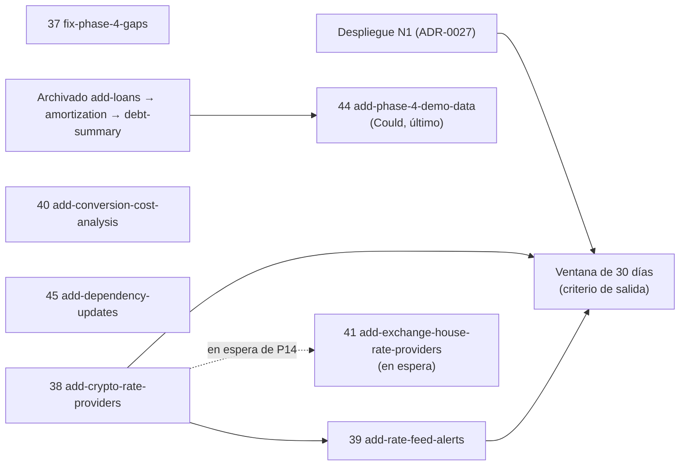

# 39 — Informe de cierre de Phase 4 y diseño de Phase 5

> **Estado:** Plan ajustado con las decisiones de [docs/41](41-phase-5-consolidation-decisions.md) (D219–D250); sin changes de OpenSpec todavía · **Fecha:** 2026-10-13 · **Relacionado:** [24-roadmap.md](24-roadmap.md) §5.4 y §5.5, [03-openspec-strategy.md](03-openspec-strategy.md) §7, [37-phase-4-consolidation-decisions.md](37-phase-4-consolidation-decisions.md), [38-estado-y-pendientes.md](38-estado-y-pendientes.md), preguntas al owner en [40-phase-5-consolidation-questions.md](40-phase-5-consolidation-questions.md), decisiones en [41-phase-5-consolidation-decisions.md](41-phase-5-consolidation-decisions.md)

Este documento cierra Phase 4 (qué se entregó, qué falta y con qué evidencia) y propone el plan de changes de Phase 5. Las preguntas del plan están en [docs/40](40-phase-5-consolidation-questions.md) y sus decisiones en [docs/41](41-phase-5-consolidation-decisions.md): respuestas del owner, decisiones por omisión (recomendación adoptada, revertible) y una pendiente (P14, change 41). La Parte B ya refleja esas decisiones; el siguiente paso es redactar los changes 37–40.

## Parte A. Cierre de Phase 4

### A.1 Resumen

Los seis changes de Phase 4 (31–36) están implementados y fusionados en `main`. Tres están archivados (`add-credit-cards`, `add-savings-goals`, `add-spendable-amount`); los otros tres (`add-loans`, `add-loan-amortization-advanced`, `add-debt-summary`) esperan un archivado encadenado que depende de una evidencia del owner: la comparación del cronograma con la tabla real de su banco (`add-loans` 8.4, D154). Dos de los cuatro criterios de salida de docs/24 §5.4 están cumplidos con tests automatizados; los otros dos dependen del uso real del owner.

### A.2 Qué se entregó

| #   | Change                           | PR                    | Capabilities                                                                                                                         | FR                                         | Estado                                                      |
| --- | -------------------------------- | --------------------- | ------------------------------------------------------------------------------------------------------------------------------------ | ------------------------------------------ | ----------------------------------------------------------- |
| 31  | `add-loans`                      | #101                  | `debt/loans`, `debt/amortization` (nuevas), `commitments/recurrence-engine`, `transactions/transaction-recording`                     | FR-DEBT-001..003, 006, 007, 011            | Fusionado; tareas 8.3 (Could) y 8.4 (owner) abiertas        |
| 32  | `add-credit-cards`               | #102 (archivo #103)   | `debt/credit-cards` (nueva), `commitments/recurrence-engine`, `reporting/cash-flow-calendar`, `notifications/alerts`                  | FR-DEBT-012..017                           | Archivado                                                   |
| 33  | `add-savings-goals`              | #104 (archivo #105)   | `goals/savings-goals` (nueva), `notifications/alerts`, `planning/budgets`, `reporting/dashboard`, `transactions/transfers`           | FR-GOALS-001..010                          | Archivado                                                   |
| 34  | `add-loan-amortization-advanced` | #107                  | `debt/amortization`, `debt/loans`, `commitments/recurrence-engine`                                                                   | FR-DEBT-004, 005, 008..010                 | Fusionado, tareas completas; archivar después de `add-loans` |
| 35  | `add-debt-summary`               | #109                  | `debt/loans`, `reporting/dashboard`                                                                                                  | FR-DEBT-018 (Should por D203)              | Fusionado, tareas completas; archivar al final de la cadena |
| 36  | `add-spendable-amount`           | #112 (archivo #113)   | `reporting/dashboard`                                                                                                                | FR-PLANNING-024 (Q5)                       | Archivado                                                   |

Correcciones de la fase: #106 (consultas pg secuenciales en la unidad de trabajo y aserciones numéricas acotadas) y #111 (TC-DEBT-AMORT-033 intermitente por redondeo).

**Contextos nuevos:** `@pf/debt` (schema `debt`: 8 tablas de préstamos, 9 de tarjetas y `debt.loan_rate_change`) y `@pf/goals` (schema `goals`, 7 tablas). Puerto público `RecurringDefinitionPort` en COMMITMENTS, compartido por DEBT y GOALS. Jobs nuevos: `debt.card-daily` y `goals.daily-evaluation`.

**Catálogo de test cases de la fase** (archivos en `tests/cases/`, por prefijo):

| Prefijo                  | TC  | Automatizados | Nota                                                                              |
| ------------------------ | --- | ------------- | --------------------------------------------------------------------------------- |
| `TC-DEBT-LOAN`           | 52  | 51            | TC-DEBT-LOAN-003 `deprecated` (lo reemplaza TC-DEBT-LOAN-046 al habilitar alemán) |
| `TC-DEBT-AMORT`          | 44  | 44            |                                                                                   |
| `TC-DEBT-CARD`           | 37  | 37            |                                                                                   |
| `TC-DEBT-SUMMARY`        | 10  | 10            |                                                                                   |
| `TC-GOALS-SAVINGS`       | 50  | 50            |                                                                                   |
| `TC-REPORTING-SPENDABLE` | 15  | 15            | Incluye el benchmark nightly TC-REPORTING-SPENDABLE-014                           |

`pnpm traceability:check` en `main` (2026-10-13): **941 TC válidos, 713 requirements, 431 archivos de test, 1 advertencia** (R3 de TC-PLANNING-EXIT-001, criterio de salida de Phase 2 que espera al owner; ninguna de Phase 4).

### A.3 Criterios de salida (docs/24 §5.4)

| Criterio                                                                         | Evidencia                                                                                                                                                                                                                                                                       | Estado                        |
| -------------------------------------------------------------------------------- | ------------------------------------------------------------------------------------------------------------------------------------------------------------------------------------------------------------------------------------------------------------------------------- | ----------------------------- |
| Cronograma French coincide al centavo con una tabla real del banco (o diferencia explicada) | La función está lista y probada con montos inventados: tabla pegada como referencia versionada (TC-DEBT-AMORT-015), coincidencia total (TC-DEBT-AMORT-017), diferencia explicada con texto, autor y fecha (TC-DEBT-AMORT-020), adopción de la tabla como versión custom (TC-DEBT-AMORT-028). Falta que el owner cargue su tabla real fuera del repositorio y registre `MATCH` o `EXPLAINED` (`add-loans` 8.4, D154). | **Pendiente del owner**       |
| Σ principal de cuotas = principal                                                | TC-DEBT-AMORT-004 (ejemplo) y TC-DEBT-AMORT-005 (PBT: suma exacta, sin componentes negativos, total = suma), automatizados.                                                                                                                                                      | **Cumplido**                  |
| Los pagos de tarjeta no cuentan como gasto                                       | TC-DEBT-CARD-015 ("exit criterion de Phase 4") y TC-TRANSACTIONS-CARDPAYMENT-001 (transferencia de activo a pasivo), automatizados; la spec `reporting/net-worth` exige que transferencias y pagos de tarjeta no cambien el patrimonio.                                          | **Cumplido**                  |
| Metas del owner con estado calculado                                             | La funcionalidad está completa (porcentaje, aporte requerido, fecha esperada y estado `behind`/`on-track`/`ahead` en `/goals`; procedimiento en docs/24 §5.4). Falta que el owner registre sus metas reales y lo confirme.                                                       | **Pendiente del owner**       |
| Objetivo de la fase: Q5 completo y Q9                                            | Q5 con `add-spendable-amount` (libre de compromisos y "según tu presupuesto", D209); Q9 con `add-savings-goals`. Ninguna pregunta del Home queda "no disponible por fase".                                                                                                        | **Cumplido** (funcionalidad)  |

Resultado de la comparación con el banco: **sin registrar**. Cuando exista, aquí se anota solo `MATCH` o `EXPLAINED` y la causa en términos generales (convención de días, cargos, fechas), sin cifras personales (docs/24 §5.4).

**Estado `READY` (docs/24 §3) de las áreas del AI Feature Gate:** G6 (`goals/savings-goals`) y G7 (`debt/*`) **no** están `READY`: `debt/loans` y `debt/amortization` aún no están archivadas en `openspec/specs/`, y ninguna capability de la fase cumple todavía "usado por el owner ≥ 2 semanas sin defectos críticos abiertos".

### A.4 Pendientes del owner

1. **Tabla del banco** (`add-loans` 8.4, D154): cargarla en Deudas → Préstamo → "Comparar con la tabla del banco" (CSV, texto pegado o filas) y dejar la comparación en `MATCH` o `EXPLAINED`. Si la tabla tiene fechas distintas a las del sistema en cuotas pendientes, la adopción como cronograma custom no está probada en ese caso (ver A.6).
2. **Metas reales** con estado calculado (fondo de emergencia, compras con dinero reservado, viaje en USD con ahorro en BOB y USD, según docs/24 §5.4).
3. **Heredados** (docs/38 §2): cierre de mes real de Phase 2 (TC-PLANNING-EXIT-001) y criterios de uso real de Phases 2 y 3.

### A.5 Archivado encadenado

El orden es obligatorio porque los deltas de los changes posteriores agregan requisitos a specs que crea el archive de `add-loans`:

1. **`add-loans`**, en cuanto el owner registre la comparación (8.4). La tarea 8.3 (Could, datos demo del préstamo) se marca `[x]` con la nota "diferida a `add-phase-4-demo-data`" (D223). Crea `debt/loans` y `debt/amortization`: reemplazar sus `## Purpose` "TBD".
2. **`add-loan-amortization-advanced`**, justo después (sus deltas MODIFIED/ADDED caen sobre las specs recién creadas).
3. **`add-debt-summary`**, al final (sus requisitos de `debt/loans` son ADDED y chocarían con el archive de `add-loans` si fuera antes). Antes de archivarlo quedan los docs que su tarea 8.1 dejó a la sesión principal: `docs/14` §10, `docs/28` (sección "Metas y deudas" del Home, D207) y el as-built en `docs/03` §7.

Mientras la cadena no se archive, el plan de Phase 5 no debe tocar `debt/loans` ni `debt/amortization` (ningún change propuesto lo hace).

### A.6 Deuda técnica conocida de Phase 4

Detalle vivo en [docs/38](38-estado-y-pendientes.md) §4. Resumen por área:

- **Préstamos:** adopción de una tabla del banco con fechas distintas en cuotas pendientes sin probar (la clave de la ocurrencia es el número de cuota); simulador de pago anticipado sin benchmark del p95 < 300 ms (el test usa 3 s); UI: la lista consulta cada detalle por separado (máx. 50), un borrador no se edita desde la pantalla (sí por `PATCH`), notas y etiquetas de transacciones `LOAN_*` no editables desde la UI.
- **Tarjetas:** el ciclo con saldo inicial queda `consistent = false` (cifras correctas); `nextDueDate` puede apuntar a un vencimiento pasado recién registrada una tarjeta con deuda previa; las cuotas no se rotulan en Q8.
- **Metas:** anular un aporte del que ya se retiró una parte deja el fondo en negativo sin bloquearlo; el job diario corre cada hora (idempotente).
- **Q5:** supuestos sin spec (sin periodo que cubra hoy se usa el mes calendario; "N tarjetas sin pago programado" no distingue mínimo de total); un aporte manual pendiente hacia una cuenta no líquida de una meta con plan puede contar dos veces hasta postearse (riesgo aceptado).
- **Datos demo** de tarjetas, metas y préstamos: tareas Could no hechas.
- **Plataforma:** presupuesto de conexiones en 55 de 60 (API 22 + worker 33); limitador de tasa en memoria (una réplica).

El change de correcciones `fix-phase-4-gaps` (D222) toma su alcance de esta lista.

## Parte B. Diseño de Phase 5 — FX y cripto avanzado

### B.1 Alcance según docs/24 §5.5

- **Objetivo:** ampliar las tasas automáticas más allá del dólar paralelo y analizar el costo real de convertir.
- **Ya hecho en Phase 1** (ADR-0025, D29): puerto `MarketRateProvider`, scheduler, fallback, obsolescencia, anomalías retenidas con confirmación, atribución, estado de providers, paralelo.bo y bo.dolarapi.com. El catálogo base ya incluye BTC (8) y ETH (18); el tipo de fuente `USER_CONVERSION` está reservado pero sin uso.
- **Pendiente para Phase 5:** más providers (exchanges cripto, casas de cambio, bancos), precios cripto y de commodities, alertas de obsolescencia y anomalía vía NOTIFY (hoy solo se ven en el estado de providers), análisis de spread y fees (FR-FX-011, Should), precios de commodities (FR-FX-012, Should) y valoración de activos no monetarios (FR-REPORTING-017, Should).
- **Criterios de salida:** tasas diarias de todos los pares del owner (incl. cripto) sin intervención manual por 30 días; ninguna tasa histórica modificada (ya cubierto por TC-FX-HISTORICAL-001/002 y NFR-DATA-006: se repite como regresión); alertas de obsolescencia funcionando.
- **FR de la fase:** Must ninguno nuevo (EPIC-17 FEAT-17.1 es Must, pero sus FR FR-FX-009/010 ya son de Phase 1 y aquí se generalizan); Should FR-FX-011, FR-FX-012, FR-REPORTING-017 y US-182 (alertas).

### B.2 Principios del plan

1. **Ningún provider sin términos de uso verificados** (NFR-COMP-007, RISK-023): cada fuente nueva pasa por una verificación de ToS y licencia documentada en ADR-0025 (o un ADR nuevo) antes de su adapter; sin scraping prohibido; las consultas no envían datos del usuario (FR-FX-015).
2. **Generalizar antes de multiplicar:** el primer change convierte la lista fija de pares de Phase 1 en pares configurables por workspace; los providers nuevos se enchufan sobre eso.
3. **Sin asientos por valoración:** precios y valoraciones de activos no generan entries (FR-FX-012, FR-REPORTING-017); el ledger sigue siendo la única fuente de verdad de saldos.
4. **Changes condicionados al uso real:** commodities, valoración de inversiones y providers de casas de cambio solo entran si el owner los necesita (docs/00 pregunta abierta 4; RISK-005). Por D221 el owner tiene cripto distinta de USDT y no tiene commodities ni inversiones: 42 y 43 pasan intactos a Phase 7 o al backlog; 41 espera P14 (D232).
5. **Sin consumidores nuevos de eventos salvo justificación** (presupuesto de conexiones 55/60).

### B.3 Lista ordenada de changes

La numeración continúa la de docs/03 §7. Plan activo según [docs/41](41-phase-5-consolidation-decisions.md); los números de los changes en espera o diferidos se conservan para no renumerar.

| Orden | Change                         | Prioridad / condición                                | Capabilities (specs afectadas)                                                                                                                                          | Depende de                                                   | Decisiones                  | TC estimados |
| ----- | ------------------------------ | ---------------------------------------------------- | ----------------------------------------------------------------------------------------------------------------------------------------------------------------------- | ------------------------------------------------------------ | --------------------------- | ------------ |
| 37    | `fix-phase-4-gaps`             | Should (D222)                                        | MODIFIED `debt/credit-cards`, `goals/savings-goals`, `reporting/dashboard`; préstamos solo UI y rendimiento, sin deltas en `debt/loans` ni `debt/amortization`            | Phase 4 fusionada                                            | D222                        | 8–12         |
| 38    | `add-crypto-rate-providers`    | Must (US-181)                                        | MODIFIED `fx/market-rate-providers` (pares configurables, provider cripto, backfill), MODIFIED `fx/market-rates` (tipo `MARKET`), `identity/workspace-portability`      | Phase 1 (FX), Phase 2 (portabilidad); ToS verificado (D225)   | D220, D221, D225–D230, D250 | 17–23        |
| 39    | `add-rate-feed-alerts`         | Should (US-182; requerido por el criterio de salida) | ADDED `notifications/alerts` (tipos de alerta FX), MODIFIED `fx/market-rate-providers` (eventos de obsolescencia, recuperación y anomalía retenida)                      | 38, Phase 2 (NOTIFY)                                         | D233–D236, D249             | 9–12         |
| 40    | `add-conversion-cost-analysis` | Should (FR-FX-011, US-183)                           | ADDED `fx/conversion-pricing`; MODIFIED `fx/market-rates` (observaciones `USER_CONVERSION`, D231)                                                                       | Phase 1 (conversiones)                                       | D231, D244–D247, D249       | 10–13        |
| 44    | `add-phase-4-demo-data`        | Could; último y opcional (D223)                      | MODIFIED `identity/demo-data` (suscripciones, tarjetas, metas y préstamos de demostración)                                                                              | cadena de archivado de Phase 4                               | D223                        | 3–4          |
| 45    | `add-dependency-updates`       | Should; Platform track de docs/24 §6 (D224)          | MODIFIED `platform/delivery-pipeline` (Renovate semanal sin automerge de majors; nightly de rendimiento con seed `large`)                                                | ninguna                                                      | D224                        | 2–3          |

**Total estimado del plan activo:** 49–67 TC (`TC-DEBT-CARD`, `TC-GOALS-SAVINGS`, `TC-DEBT-AMORT`, `TC-FX-PROVIDER`, `TC-REPORTING-NETWORTH`, `TC-NOTIFICATIONS-FX`, `TC-FX-COST`, `TC-IDENTITY-DEMO`, `TC-PLATFORM-PIPELINE`). Los prefijos `TC-FX-COMMODITY` y `TC-ACCOUNTS-VALUATION` quedan reservados para los changes diferidos.

**En espera y diferidos** (fuera del plan activo):

| Orden | Change                              | Situación                                                                                                                                             | Decisiones      |
| ----- | ----------------------------------- | ----------------------------------------------------------------------------------------------------------------------------------------------------- | --------------- |
| 41    | `add-exchange-house-rate-providers` | **En espera** de P14: el owner indicará qué casas de cambio o bancos usa. Si alguna fuente califica por ToS, entra después de 38; si ninguna, se descarta. | D232            |
| 42    | `add-commodity-prices`              | **Diferido** a Phase 7 o al backlog: el owner no tiene commodities. P19, P21 y P22 se reabren si vuelve al plan.                                         | D221, D237–D240 |
| 43    | `add-asset-valuations`              | **Diferido** a Phase 7 o al backlog: el owner no tiene inversiones. P19–P25 se reabren si vuelve al plan.                                               | D221, D237–D243 |

### B.4 Detalle por change

**37 `fix-phase-4-gaps`** (D222). Correcciones acotadas de A.6, como `fix-phase-2-gaps` (D113): `nextDueDate` nunca en el pasado para una tarjeta recién registrada; ciclo con saldo inicial `consistent = true` cuando las cifras cuadran; avisar (sin bloquear, D222) la anulación de un aporte con retiros posteriores; UI de préstamos (lista sin N+1, edición del borrador); benchmark del simulador de pago anticipado (p95 < 300 ms). TC estimados: 8–12 (`TC-DEBT-CARD`, `TC-GOALS-SAVINGS`, `TC-DEBT-AMORT`, más un TC de rendimiento). Riesgo: tocar `debt/loans` antes del archivado; por eso las correcciones de préstamos se limitan a UI y rendimiento, sin deltas de spec sobre `debt/loans` ni `debt/amortization`.

**38 `add-crypto-rate-providers`** (Must). Alcance: pares configurables por workspace por OWNER y EDITOR, con auditoría y sin máquina de estados (default: monedas habilitadas frente a la moneda base; el criterio de 30 días se mide sobre esa lista; D220, D230, D250); provider de precios cripto: API pública de un exchange como principal y un agregador u otro exchange como respaldo independiente, tras verificar ToS (D225), que registra las criptomonedas del owner contra USDT (D227); tipo de tasa `MARKET` (D226); polling 15 min, obsolescencia 60 min y anomalía 5 % para fiat y stablecoins y 10 % para cripto volátil, configurables (D228); backfill de cierres diarios desde la primera fecha con saldo (D229) para que la serie de patrimonio y los snapshots tengan tasa histórica; atribución por provider (FR-FX-014); la valoración en BOB usa la tasa cruzada por moneda pivote ya especificada en `fx/market-rates`. Contratos: `rateType` ampliado (aditivo, `x-extensible-enum`), `provider` ampliado en `fx.RateRecorded.v1` (aditivo), endpoints de configuración de pares (`GET`/`PUT W/fx/rate-pairs`, nombres a fijar en el design), estado de providers con los nuevos. TC estimados: 15–20 `TC-FX-PROVIDER` (contrato del adapter con fixtures sin red, límites y `Retry-After`, backfill idempotente, anomalía con umbral por clase, pares configurados, sin datos del usuario) + 2–3 `TC-REPORTING-NETWORTH` (cripto valorado con la cruzada y punto histórico). Riesgos: RISK-023 (ToS, disponibilidad, cambio de formato), RISK-003 (inmutabilidad del histórico), volatilidad que dispara anomalías, límites de uso del provider; sin conexiones nuevas (reutiliza la cola de providers).

**39 `add-rate-feed-alerts`** (Should; cubre "alertas de staleness funcionando"). Alcance: alerta in-app (y email según preferencias, sin valores de tasa, FR-NOTIFY-006) a OWNER y EDITOR (D235) cuando un par configurado lleva más de N horas sin tasa fresca de ningún provider (default 6 h, configurable), una vez por episodio y con aviso de recuperación (D233), y una vez por muestra retenida como anómala, con enlace para confirmar o rechazar (D234); la muestra sigue retenida hasta la respuesta (D236). La falla no transitoria de un provider no alerta en Phase 5 (D233): queda en el estado de providers. Deduplicación por episodio (FR-NOTIFY-005), i18n es/en/pt. Sin consumidor nuevo: la detección reutiliza el job de providers (D249). Contratos: eventos nuevos propuestos `fx.RateFeedStale.v1`, `fx.RateFeedRecovered.v1` y `fx.RateAnomalyRetained.v1` (catálogo en docs/11), tipos nuevos de notificación en el enum extensible. TC estimados: 7–9 `TC-NOTIFICATIONS-FX` + 2–3 `TC-FX-PROVIDER`. Riesgo: ruido de alertas con un provider inestable (mitigado por el umbral en horas y el aviso único por episodio).

**40 `add-conversion-cost-analysis`** (Should, FR-FX-011). Alcance: spread y fees promedio por canal (contraparte más par de cuentas; "Sin canal" si no hay contraparte, D244), par y periodo financiero (o mes calendario), ponderados por monto convertido en moneda base (D246), contra la tasa de referencia registrada, con exclusión y conteo aparte de las conversiones sin referencia (D247); vista en la UI y exportación CSV; registro de cada conversión posteada como observación `USER_CONVERSION` de su par, visible en el historial y nunca usada para valorar (D231, cierra D26). Contratos: una consulta de lectura (`GET W/reports/conversion-costs` o equivalente) que REPORTING compone sobre la consulta pública de `ConversionDetail` (D245; el design reevalúa si se apoya en las observaciones). El consumidor de `ConversionRecorded.v1`/`ConversionRevised.v1` en FX es el único nuevo de la fase: el change sube antes `max_connections` y valida el test de arranque del worker (D249). TC estimados: 8–10 `TC-FX-COST` + 2–3 para las observaciones `USER_CONVERSION`. Riesgos: conversiones antiguas sin referencia; presupuesto de conexiones.

**41 `add-exchange-house-rate-providers`** _(en espera de P14, D232)_. Alcance: adapters solo para casas de cambio o bancos que publiquen sus tasas con API o términos que permitan la consulta automática; registran compra y venta como tipos propios (convención D39) y quedan como referencia `BANK` para conversiones y para el análisis de costo. Si ninguna fuente califica, el change se descarta y el owner sigue registrando tasas `BANK` manuales. TC estimados: 6–8 `TC-FX-PROVIDER`. Riesgos: RISK-023 alto (sitios sin API, términos restrictivos, cambios de formato sin aviso).

**42 `add-commodity-prices`** _(diferido por D221 a Phase 7 o al backlog; se conserva como referencia)_. Alcance: alta de monedas `COMMODITY`/`CUSTOM` por workspace (comando `RegisterCommodity` previsto en docs/05; hoy el catálogo solo admite `FIAT`/`CRYPTO`), escala inmutable una vez usada, precios manuales con la misma inmutabilidad y reemplazo auditado que las tasas, y provider de precios solo si existe una fuente válida (pregunta 22). Cuentas denominadas en esa moneda se valoran por precio sin asientos. TC estimados: 8–10 `TC-FX-COMMODITY` + 2 `TC-REPORTING-NETWORTH`. Riesgos: RISK-005 (sobre-modelar), unidades (gramo, onza troy).

**43 `add-asset-valuations`** _(diferido por D221 a Phase 7 o al backlog; se conserva como referencia)_. Alcance: valoraciones periódicas manuales de cuentas `INVESTMENT`/`MANUAL_ASSET` (sin asientos), patrimonio con la última valoración a la fecha, ganancia no realizada frente al costo, auditoría de cada valoración y portabilidad. Contratos: endpoints de valoraciones por cuenta, evento propuesto `accounts.AccountValuationRecorded.v1` (si el dueño es ACCOUNTS, pregunta 20). TC estimados: 10–12 `TC-ACCOUNTS-VALUATION` / `TC-REPORTING-NETWORTH`. Riesgos: doble verdad entre saldo contable y valoración; descomposición de ΔNW (docs/14 §4.1) que se espera en Phase 7.

**44 `add-phase-4-demo-data`** (Could, último y opcional; D223). Alcance: datos de demostración de suscripciones, tarjetas, metas y préstamos en el workspace demo (ADR-0026), cerrando las tareas Could de Phases 3 y 4. TC estimados: 3–4 `TC-IDENTITY-DEMO`. Riesgo: RISK-026 (tablas nuevas deben estar en `platform.workspace_scoped_table` para la purga).

**45 `add-dependency-updates`** (Should, Platform track de docs/24 §6; D224). Alcance: Renovate con agrupación semanal y sin automerge de majors; nightly de rendimiento con seed `large` (el SBOM ya existe en `main.yml`). No cambia la protección de `main` ni los checks requeridos; si hiciera falta, requiere confirmación aparte del owner. TC estimados: 2–3 `TC-PLATFORM-PIPELINE`.

### B.5 Dependencias

37, 40 y 45 son independientes del resto y pueden ir en paralelo con 38; el orden de la tabla prioriza el Must y el criterio de salida. La ventana de 30 días empieza cuando N1 está desplegado y consulta los providers de forma continua, con 38 y 39 fusionados (D248). 42 y 43 están diferidos (D221) y no aparecen en el grafo.

### B.6 Riesgos de la fase

| Riesgo                                     | Dónde                  | Mitigación propuesta                                                                                                    |
| ------------------------------------------ | ---------------------- | ----------------------------------------------------------------------------------------------------------------------- |
| RISK-023 fuentes FX sin ToS o inestables   | 38, 41 (en espera)     | Verificación de ToS antes de cada adapter; ACL con JSON Schema propio; respaldo independiente; fixtures sin red en CI.   |
| RISK-003 corrupción del histórico FX       | 38, 40                 | Misma inmutabilidad y reemplazo auditado; TC-FX-HISTORICAL-001/002 como regresión en cada change.                        |
| RISK-005 sobre-modelar inversiones         | 42, 43 (diferidos)     | Mitigado por D221: commodities e inversiones fuera de Phase 5.                                                          |
| Criterio de 30 días sin intervención       | Cierre de fase         | Despliegue N1 (ADR-0027) antes de abrir la ventana (D248).                                                           |
| Presupuesto de conexiones (55/60)          | 39, 40                 | Alertas en el job de providers; el único consumidor nuevo (40, D231) sube `max_connections` antes (D249).               |
| RISK-004 alcance para un desarrollador     | Toda la fase           | Plan activo de seis changes (uno Could); 41 en espera y 42–43 diferidos; docs/24 estima 3 semanas para la fase.                                     |

### B.7 Qué no entra en Phase 5

- Descomposición del cambio de patrimonio (FX_revaluation, Asset_revaluation; docs/14 §4.1) y reportes de costo avanzados: Phase 7 (`reporting/financial-reports`), (D242).
- Historial de trades de exchanges como conversiones (US-204, `imports/banking-providers`): Phase 6.
- Commodities y valoración de inversiones (changes 42 y 43): diferidos a Phase 7 o al backlog (D221).
- Alerta por falla no transitoria de un provider: no entra (D233); queda en el estado de providers.
- Custodia de cripto o conexión a wallets on-chain: fuera de alcance (docs/25 W-12).
- Morosidad de préstamos (D159), feriados (D160), interés rotativo estimado (D173) y tarjetas en el simulador (D198): siguen fuera.
